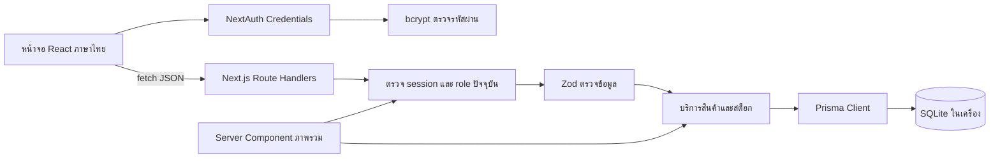
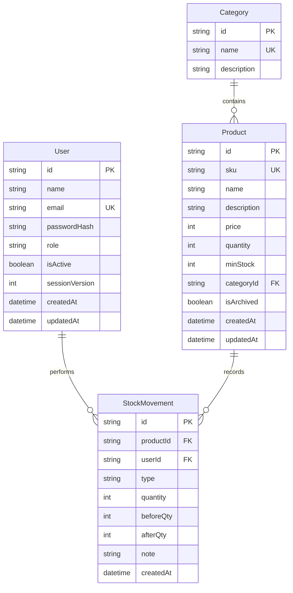

# รายงานโครงงาน ระบบจัดการคลังสินค้าอัจฉริยะ

## ภาพรวมและขอบเขต

ระบบช่วยสำนักงานติดตามสินค้า ลดข้อผิดพลาดจากการแก้จำนวนโดยไม่มีประวัติ และกำหนดสิทธิ์เจ้าหน้าที่กับผู้ดูแลระบบ เป้าหมายคือสาธิตข้อกำหนดวิชาได้ครบ ใช้งานบน Windows localhost และข้อมูลยังอยู่หลังปิดเปิดโปรแกรม

## สถาปัตยกรรม

Pages ที่ป้องกันอยู่ใน route group `(protected)` ซึ่งไม่เพิ่มชื่อกลุ่มลง URL; layout ตรวจ session ก่อนแสดง sidebar แต่ API ตรวจ session และสิทธิ์ซ้ำเสมอ การรวมธุรกิจ API ใน catch-all route ทำให้รูปแบบผลลัพธ์และการจัดการ error อยู่จุดเดียว URL ที่ผู้ใช้เรียกยังเป็น REST ตามรายการใน README ไม่มี server action ที่ใช้เขียนข้อมูล

## ER Diagram

เพิ่ม `isArchived` เพื่อคงประวัติ และ `sessionVersion` เพื่อเพิกถอน session เมื่อแก้บัญชี ใช้ string สำหรับ role/type โดย Zod จำกัดค่า และ migration มี SQL trigger ตรวจค่า valid ที่ฐานข้อมูล SQLite ไม่ต้องใช้ฐานข้อมูลภายนอก Foreign keys ใช้ Restrict ไม่ cascade ลบประวัติ

## ฟีเจอร์และหลักการทำงาน

### CRUD

`createProduct` บันทึกสินค้าและยอดเปิดใน transaction เดียวกัน `getProducts` และ `getProduct` อ่านเฉพาะสินค้าที่ไม่เก็บถาวร `updateProduct` แก้รายละเอียดและหมวดหมู่โดยไม่รับ quantity ส่วน `deleteProduct` ตรวจประวัติก่อนลบจริงหรือเก็บถาวร ปุ่มลบต้องยืนยันและใช้สิทธิ์ Admin

### Validation

`lib/validations.ts` ใช้ Zod ตรวจชื่อ 2–150 ตัวอักษร SKU ตัวอักษรอังกฤษ/ตัวเลข/_/- จำนวนเต็มไม่ติดลบ และค่าที่ไม่ใช่ตัวเลขไม่ผ่าน ราคา API ใช้สตางค์เป็นจำนวนเต็ม UI อนุญาตบาทไม่เกินสองตำแหน่งทศนิยม ไม่เปลี่ยนค่าว่างให้เป็นศูนย์ ตรวจ categoryId ที่มีจริงและฐานข้อมูลป้องกันข้อมูลซ้ำ ข้อความที่ผู้ใช้เห็นเป็นไทย

### Authentication และ Authorization

NextAuth Credentials ตรวจ bcrypt hash ไม่ส่ง hash กลับ client ใช้ JWT session อายุ 8 ชั่วโมง มี cookie และ CSRF ของ NextAuth และตรวจ origin สำหรับ API แก้ข้อมูล หน้าป้องกันใช้ `getCurrentUser` อ่านผู้ใช้จากฐานข้อมูล สิทธิ์เปลี่ยนมีผลทันที การแก้บัญชีเพิ่ม sessionVersion และ Admin คนสุดท้ายถูกป้องกันใน transaction ไม่มี public registration

### Search และ Filter

React รับค่าค้นหาและตัวกรองส่งเป็น query string; Prisma ใช้ OR ค้นหา name/SKU, AND หมวดหมู่/สถานะ และ field reference เปรียบ quantity กับ minStock ใช้ skip/take สำหรับ pagination การแก้เงื่อนไขกลับหน้า 1 คิวรีข้อมูลและจำนวนอยู่ใน transaction เดียวกัน

### REST API

GET อ่าน POST สร้าง PUT แก้ DELETE ลบ ใช้ Next.js Route Handlers จริง ทุก endpoint มี session check และ endpoints ที่จำกัดบทบาทคืน 403 ให้ Staff มีรูปแบบ JSON สม่ำเสมอ 400/401/403/404/409/500 ไม่มี stack trace ใน response ดู payload และตารางทั้งหมดใน README

### สต็อกและความถูกต้อง

`changeStock` คำนวณยอดใหม่ ตรวจไม่ติดลบและไม่เกินเพดาน 100 ล้านหน่วย จากนั้น `updateMany` มีเงื่อนไข quantity เท่ากับค่าที่อ่าน ตรวจ count=1 ก่อนสร้าง audit log ภายใน transaction เดียวกัน ทำให้คำขอที่เบิกเกินยอดร่วมกันสำเร็จได้เพียงคำขอที่มีสินค้าพอ ผู้ใช้ที่ทำรายการมาจาก session ไม่รับ userId จาก client

### หน้าจอ

Prompt แบบ local, พื้นขาว/เทา, sidebar, header, KPI, ตาราง, ฟอร์ม, สถานะ loading/empty/error, ข้อความผลลัพธ์และ dialog ยืนยัน ใช้ฟอร์ม native พร้อม label เพื่อเข้าถึงได้บนมือถือ รายงานมูลค่าจากยอดปัจจุบันคูณราคา ไม่มีต้นทุนเฉลี่ยหรือบัญชีซื้อขาย

## ผลการทดสอบ

ผลตรวจรอบสุดท้ายอยู่ใน [FINAL_AUDIT.md](FINAL_AUDIT.md): ปรับ handleSubmit/state/เงื่อนไข stock ให้อ่านง่ายขึ้น คง route และ schema เดิม เพิ่ม cancellation คำค้นกับข้อความ network error ไทย และเปลี่ยน test runner ไปใช้ฐานข้อมูลแยกโดยไม่แตะ dev.db

ดู [TEST_REPORT.md](TEST_REPORT.md) สำหรับคำสั่ง ผลจริง และ mapping 25 ข้อ รวม API integration กับ SQLite และ Chromium browser ไม่ได้อ้างผลจาก mock data การรันทดสอบ production build เป็นหลักฐานการเริ่มระบบใน Windows สกรีนช็อตอยู่ใน `docs/screenshots`

## ข้อจำกัด

ดูข้อจำกัดฉบับเต็มใน README: ระบบ localhost เครื่องเดียว, ประวัติ UI 100 รายการ, ไม่มี restore/CSV/charts/MFA, login limiter อยู่ memory และยังมี audit warnings ใน dependencies สำหรับเครื่องมือพัฒนา ต้องทบทวนก่อนนำไปให้บริการจริง ไม่มีตัวอย่าง auth ของอาจารย์ให้ตรวจ จึงตรวจหลักความปลอดภัยตามข้อกำหนดแทน

## Checklist ก่อนนำเสนอ

- [ ] เปิดเครื่องและทดสอบ `start.bat` ก่อน 08:30 น.
- [ ] เปิด http://localhost:3000 และเตรียม Admin/Staff ไว้
- [ ] สำรอง `prisma/dev.db` ขณะหยุดโปรแกรม
- [ ] ทดลองค้นหา INV-101 และกรองสินค้าใกล้หมด
- [ ] เตรียมสร้าง SKU ใหม่ที่ยังไม่ใช้ เช่น DEMO-20261019
- [ ] ทดลองเพิ่ม/แก้ไข/เบิก/เก็บถาวร
- [ ] เปิด Network แสดง GET POST PUT DELETE พร้อม status
- [ ] เปิดไฟล์ตาม CODE_WALKTHROUGH_TH และผลทดสอบ
- [ ] เตรียมตอบเรื่องราคาเป็นสตางค์ สิทธิ์ server และ transaction
- [ ] ปิดอินเทอร์เน็ตทดสอบหลังติดตั้งและ build หากต้องการสาธิต offline จริง
