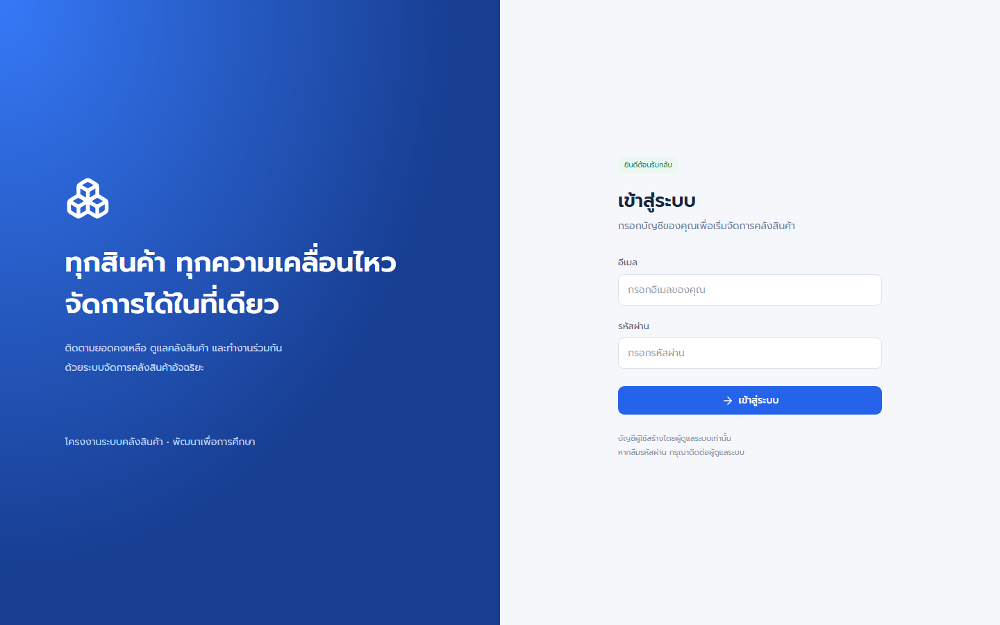
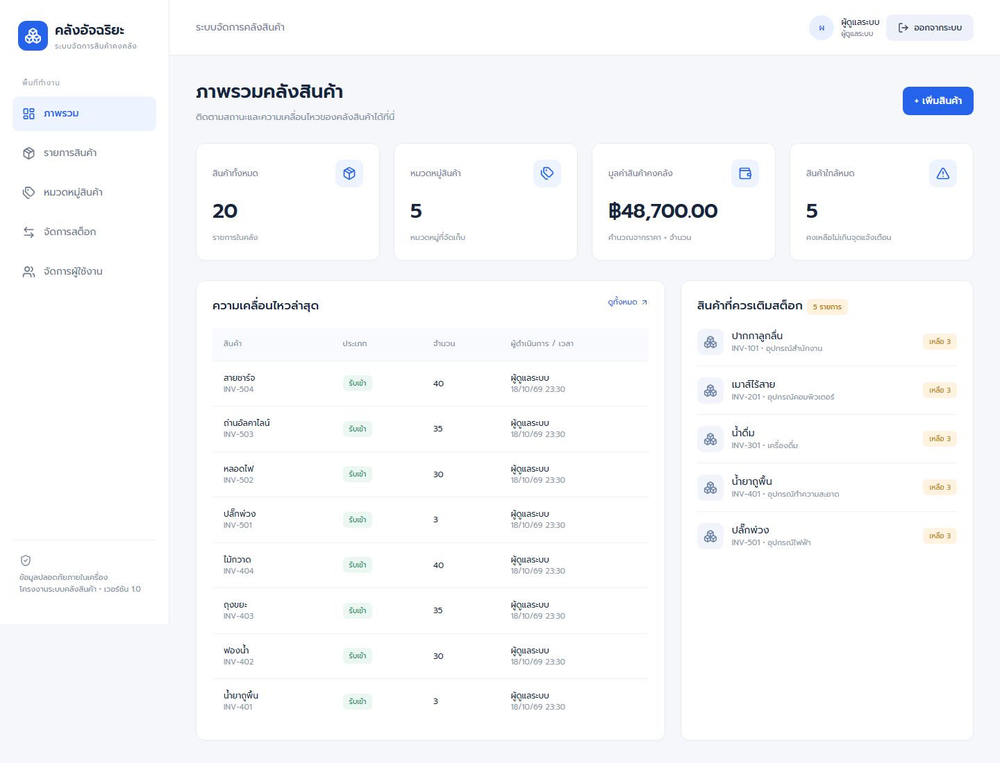
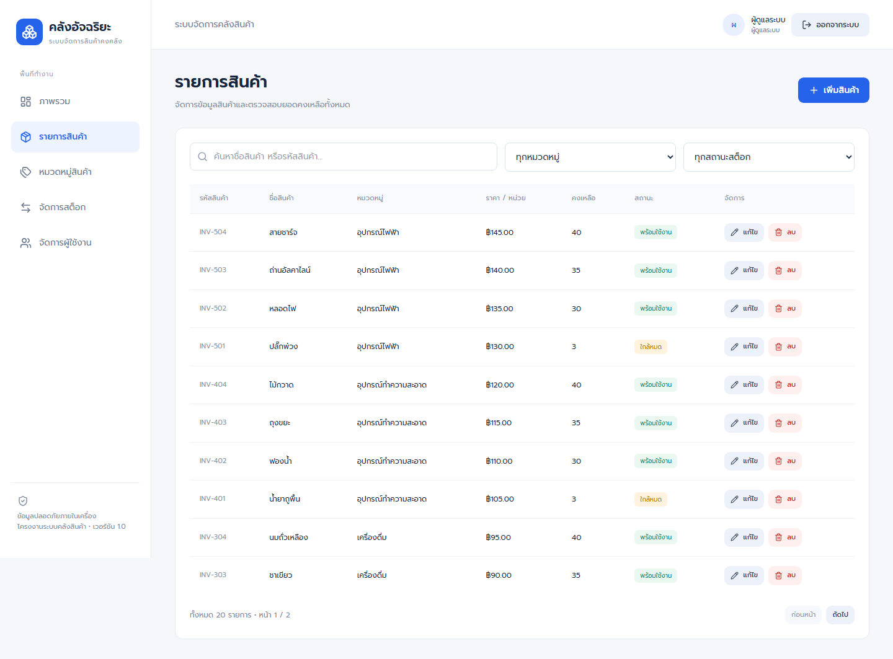
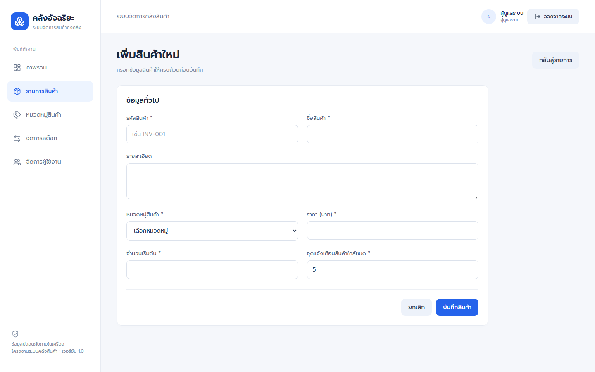
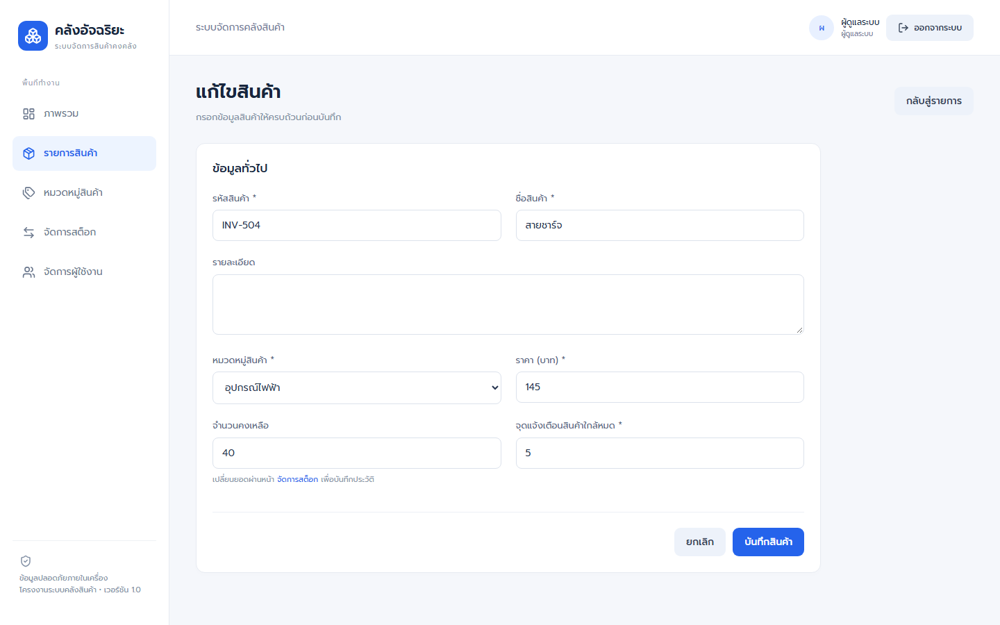
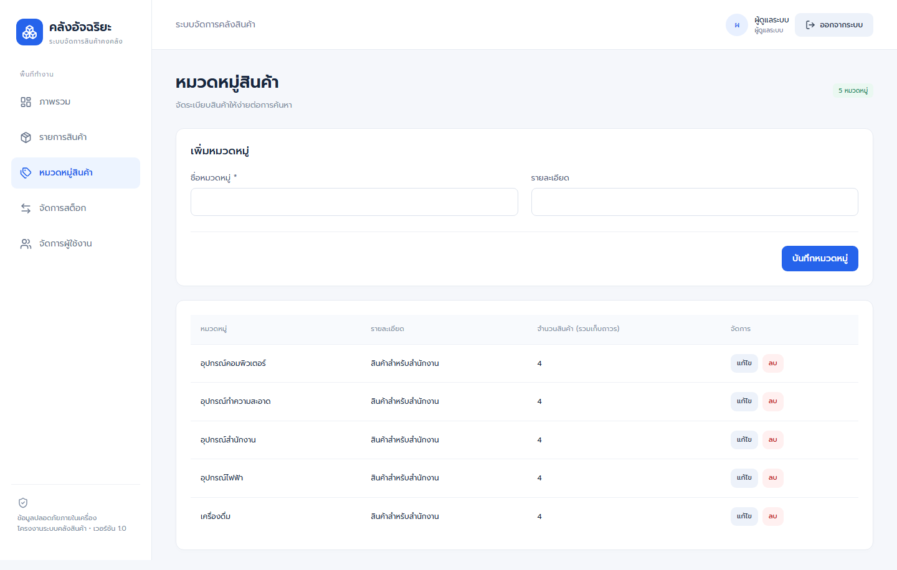
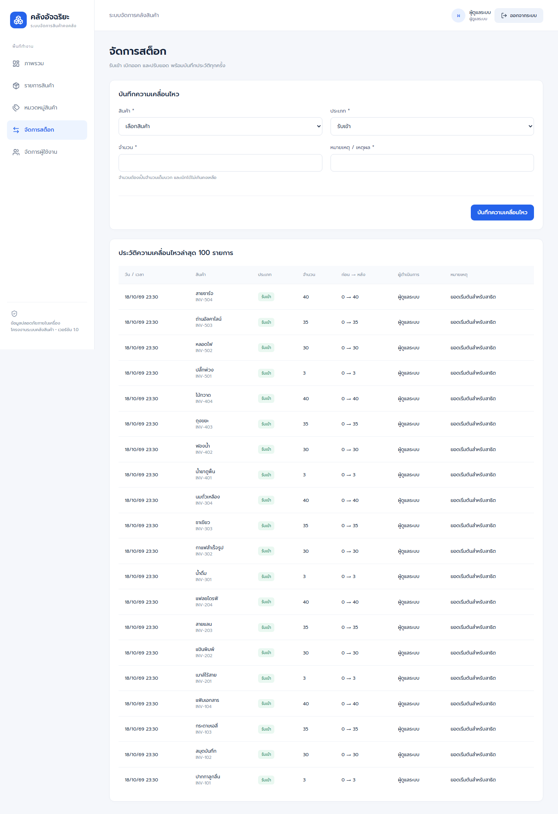
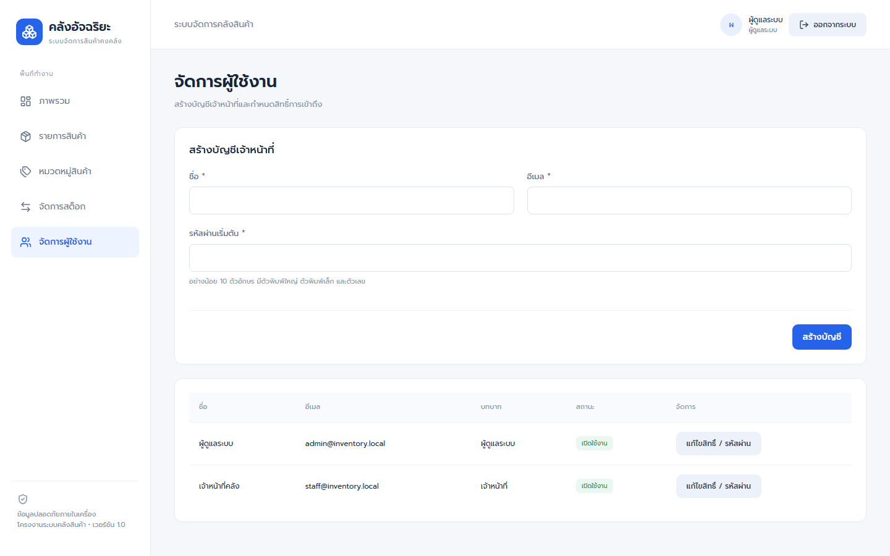
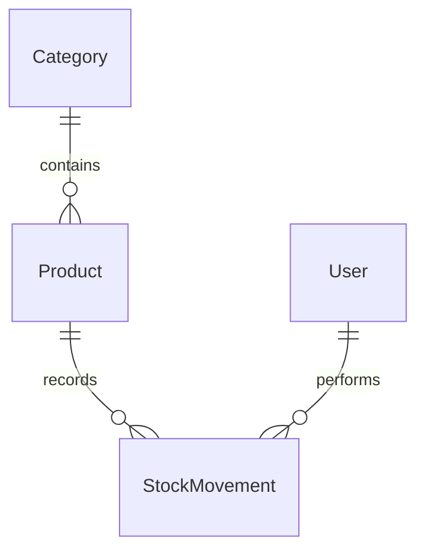

# Smart Inventory Management System
## ระบบจัดการสินค้าและคลังสินค้า

โครงงาน Final Project สำหรับจัดการสินค้าและติดตามความเคลื่อนไหวของคลังสินค้า ออกแบบให้ใช้งานบน Windows ผ่าน localhost ด้วยฐานข้อมูล SQLite ภายในเครื่อง พร้อมหน้าจอภาษาไทยและสิทธิ์ผู้ดูแลระบบ/เจ้าหน้าที่

## 1. ภาพรวมโครงการ

การบันทึกสินค้าด้วยเอกสารหรือการแก้ยอดคงเหลือโดยไม่มีประวัติอาจทำให้ข้อมูลคลาดเคลื่อน ค้นหายาก และไม่ทราบผู้ดำเนินการ โครงการนี้จึงรวบรวมข้อมูลสินค้า หมวดหมู่ ผู้ใช้ และประวัติสต็อกไว้ในระบบเดียว เพื่อให้ตรวจสอบข้อมูลและอธิบายขั้นตอนการทำงานได้อย่างชัดเจน

วัตถุประสงค์คือพัฒนาระบบที่สาธิตข้อกำหนดรายวิชาได้ครบทั้ง 5 ข้อ ได้แก่ **CRUD, Data Validation, Authentication และ Authorization, Search และ Filter และ REST API ผ่าน GET/POST/PUT/DELETE** โดยให้ความสำคัญกับความถูกต้อง ความเข้าใจง่าย และการใช้งานในเครื่อง หลังติดตั้ง dependencies และ build แล้วระบบไม่ต้องใช้ API ฐานข้อมูล หรือฟอนต์จากภายนอกระหว่างใช้งาน

## 2. ฟีเจอร์หลัก

| ฟีเจอร์ | การทำงานจริง |
|---|---|
| CRUD สินค้า | เพิ่ม อ่าน แก้รายละเอียด และลบ/เก็บถาวรสินค้า พร้อมยืนยันก่อนลบ |
| Validation | Zod ตรวจข้อมูลบน server และฟอร์มสินค้า ตรวจ SKU ซ้ำ หมวดหมู่จริง ราคา/จำนวนไม่ติดลบ และรูปแบบข้อมูล |
| Authentication | NextAuth Credentials ตรวจ bcrypt hash มี login/logout และ session อายุ 8 ชั่วโมง ไม่มี public registration |
| Authorization | อ่าน role/active/sessionVersion จากฐานข้อมูลทุกคำขอสำคัญ บังคับสิทธิ์ที่ server ไม่อาศัยการซ่อนปุ่ม |
| Search และ Filter | ค้นชื่อหรือ SKU กรองหมวดหมู่และสินค้าใกล้หมด ใช้ร่วมกันได้ พร้อม pagination |
| REST API | Next.js Route Handlers รับส่ง JSON ผ่าน GET, POST, PUT, DELETE พร้อม HTTP status |
| Dashboard | จำนวนสินค้า หมวดหมู่ มูลค่าคงคลัง สินค้าใกล้หมด และประวัติล่าสุด คำนวณจากฐานข้อมูลจริง |
| หมวดหมู่ | Admin เพิ่ม/แก้/ลบหมวดหมู่ได้ ป้องกันลบหมวดที่ยังมีสินค้า รวมสินค้าเก็บถาวร |
| สต็อก | รับเข้า เบิกออก ปรับยอด พร้อม actor เวลาไทย ยอดก่อน/หลัง และเหตุผล ป้องกันเบิกเกินและ concurrent stock-out |
| ผู้ใช้งาน | Admin สร้าง Staff เปลี่ยน role/status และรีเซ็ตรหัสผ่าน ป้องกันปิด/ลดสิทธิ์ Admin คนสุดท้าย |

**บทบาท:** Admin ทำงานได้ทุกส่วน ส่วน Staff อ่าน/เพิ่ม/แก้รายละเอียดสินค้า จัดการสต็อก และอ่านหมวดหมู่ได้ แต่ลบสินค้า จัดการหมวดหมู่ และจัดการผู้ใช้ไม่ได้

## 3. ภาพหน้าจอโปรแกรม

ภาพทั้ง 8 ภาพถ่ายจากโปรแกรมจริงบน localhost ด้วยฐานข้อมูลสาธิตแยกจากข้อมูลผู้ใช้ รอโหลดข้อมูลและฟอนต์ครบก่อนถ่าย ใช้ viewport 1440×900 และเก็บแบบ full-page จึงอาจมีความสูงเกิน 900 พิกเซล

### หน้าเข้าสู่ระบบ

ฟอร์มอีเมลและรหัสผ่าน พร้อมข้อความแจ้งเตือนภาษาไทย ภาพนี้ไม่ได้กรอกรหัสผ่าน



### ภาพรวมคลังสินค้า

KPI และประวัติความเคลื่อนไหวอ่านจากฐานข้อมูลสาธิตจริง



### รายการสินค้า

ตารางสินค้า ช่องค้นหา ตัวกรอง สถานะคงเหลือ และการแบ่งหน้า



### เพิ่มสินค้า

บันทึกรหัส ชื่อ หมวดหมู่ ราคา จำนวนเริ่มต้น และจุดแจ้งเตือน



### แก้ไขสินค้า

แก้รายละเอียดได้ แต่เปลี่ยนจำนวนผ่านหน้าสต็อกเพื่อรักษาประวัติ



### หมวดหมู่สินค้า

Admin จัดการหมวดหมู่ ส่วน Staff อ่านได้เท่านั้น



### จัดการสต็อก

รับเข้า เบิกออก ปรับยอด และตรวจประวัติพร้อมยอดก่อน/หลังและผู้ดำเนินการ



### จัดการผู้ใช้งาน

หน้าเฉพาะ Admin สำหรับบัญชี Staff และการกำหนดสิทธิ์



## 4. เทคโนโลยีที่ใช้

เวอร์ชันจาก dependencies ที่ติดตั้งและทดสอบจริง ดูรายละเอียดการล็อกแพ็กเกจใน `package-lock.json` และติดตั้งด้วย `npm ci`

| เทคโนโลยี | เวอร์ชันที่ทดสอบ | หน้าที่ |
|---|---|---|
| Next.js | 15.5.28 | App Router, Server Components และ Route Handlers |
| React / React DOM | 19.3.1 | ฟอร์ม ตาราง state และการโต้ตอบบนหน้าเว็บ |
| TypeScript | 6.0.3 | ตรวจชนิดข้อมูลระหว่างพัฒนา |
| Tailwind CSS | 4.3.3 | ระบบ CSS ร่วมกับ stylesheet ของโครงการ |
| Prisma / Prisma Client | 6.19.3 | ORM, migrations และเข้าถึง SQLite |
| SQLite | ฐานข้อมูลแบบไฟล์ผ่าน Prisma | เก็บข้อมูลในเครื่อง ไม่ต้องติดตั้ง database server |
| NextAuth | 4.24.15 | Credentials Provider และ JWT session |
| bcryptjs | 3.0.3 | hash/compare รหัสผ่าน cost 12 |
| Zod | 4.6.7 | ตรวจข้อมูล runtime |
| Lucide React | 1.59.0 | ไอคอน |
| Prompt | @fontsource/prompt 5.3.0 | ฟอนต์ภาษาไทยแบบ local |
| Playwright | 1.64.1 | ทดสอบ HTTP และ Chromium จริง |

## 5. โครงสร้างโปรเจกต์

```text
smart-inventory-management/
├── app/
│   ├── (protected)/        หน้าระบบและ layout ตรวจ login
│   ├── api/[...path]/      REST API ธุรกิจแยก branch ตาม resource
│   ├── api/auth/[...nextauth]/  NextAuth GET/POST
│   ├── login/ unauthorized/
│   └── globals.css
├── components/
│   ├── products/           ฟอร์มและตารางสินค้า
│   ├── layout/             Sidebar/Header
│   └── ui/                 fetch helper, dialog, toast
├── lib/                    Prisma, auth, permissions, validation, services
├── prisma/
│   ├── schema.prisma
│   ├── migrations/
│   └── seed.ts
├── scripts/                setup, startup, isolated tests และ audit
├── tests/                  HTTP/Chromium regression
├── types/                  Session และ CSS declarations
├── docs/screenshots/       ภาพจากโปรแกรมจริง
├── .env.example            ตัวอย่าง config ไม่มี secret จริง
├── start.bat
├── FINAL_AUDIT.md
├── CODE_WALKTHROUGH_TH.md
└── package.json / package-lock.json
```

วงเล็บ `(protected)` เป็น route group ไม่เพิ่มลง URL ส่วน API รวมคง guard และ error response ไว้จุดเดียวเพื่อให้ตรวจสอบสิทธิ์ได้ง่าย รายละเอียดการตัดสินใจอยู่ใน [FINAL_AUDIT.md](FINAL_AUDIT.md)

## 6. ฐานข้อมูล

| ตาราง | ข้อมูลหลักและความสัมพันธ์ |
|---|---|
| User | id, name, email ที่ไม่ซ้ำ, passwordHash, role, isActive, sessionVersion, timestamps; ผู้ใช้หนึ่งคนทำหลาย StockMovement |
| Category | id, name ที่ไม่ซ้ำ, description; หมวดหนึ่งมีหลาย Product |
| Product | id, sku ที่ไม่ซ้ำ, name, description, price, quantity, minStock, categoryId, isArchived, timestamps |
| StockMovement | productId, userId, type, quantity, beforeQty, afterQty, note, createdAt; เชื่อมสินค้าและผู้ทำรายการ |



- ราคาเก็บเป็น **จำนวนเต็มหน่วยสตางค์** เช่น 99.50 บาท = 9950 ใน API/DB ส่วนหน้าเว็บแสดงบาท
- Product.quantity คือยอดปัจจุบัน ส่วน StockMovement.quantity คือขนาดส่วนต่างที่เป็นบวก
- IN/OUT รับจำนวนเพิ่ม/ลด; ADJUST รับยอดใหม่ทั้งหมด และปฏิเสธการปรับเท่ายอดเดิม
- การเปลี่ยนสต็อกใช้ transaction รวม conditional update และบันทึกประวัติ ถ้ามี concurrent conflict อาจได้ 409 และต้องลองใหม่
- สร้างสินค้าจำนวนเริ่มต้นมากกว่า 0 จะสร้าง opening movement ใน transaction เดียวกัน
- ลบสินค้าที่มีประวัติใช้ `isArchived=true` ซ่อนจากรายการ/ค้นหา/Dashboard/ตัวเลือกสต็อก แต่เก็บ history และสงวน SKU เดิม ถ้าไม่มีประวัติจึงลบจริง
- ไม่มี restore archive ใน V1 และไม่ลบผู้ใช้จริง ใช้ปิดบัญชีเพื่อรักษาประวัติ

## 7. การติดตั้งและใช้งานบน Windows

### สิ่งที่ต้องเตรียม

Windows 10/11, PowerShell, Git, Node.js 24 LTS และ npm ทดสอบจริงด้วย **Node.js 24.18.0 / npm 11.16.0** การติดตั้งแพ็กเกจครั้งแรกต้องใช้อินเทอร์เน็ต

```powershell
git clone https://github.com/Jessadaruk/smart-inventory-management.git
cd smart-inventory-management
node --version
npm --version
npm ci
```

### Environment

กรณีติดตั้งใหม่โดยยังไม่มี `.env` คำสั่ง setup จะสร้างจาก `.env.example` พร้อม NEXTAUTH_SECRET สุ่มให้อัตโนมัติ:

```powershell
npm run setup
npm start
```

ถ้าต้องการตั้งค่าด้วยตัวเอง ให้ทำก่อน setup และคัดลอกเฉพาะเมื่อยังไม่มี `.env`:

```powershell
Copy-Item .env.example .env
node -e "console.log(require('crypto').randomBytes(32).toString('hex'))"
```

นำค่าที่สร้างได้ไปแทน NEXTAUTH_SECRET ใน `.env` และตั้ง SEED_ADMIN_PASSWORD / SEED_STAFF_PASSWORD ตามต้องการ ห้ามใช้ข้อความ placeholder เป็น secret จริงและห้ามเผยแพร่ `.env`

| ตัวแปร | ความหมาย |
|---|---|
| DATABASE_URL | SQLite เช่น `file:./dev.db` |
| NEXTAUTH_URL | URL ที่ใช้เปิด เช่น `http://localhost:3000` |
| NEXTAUTH_SECRET | ค่าสุ่มสำหรับ session ต้องเก็บเป็นความลับ |
| SEED_ADMIN_PASSWORD / SEED_STAFF_PASSWORD | รหัสผ่านสำหรับสร้างบัญชี demo ที่ยังไม่มี |

`npm run setup` สร้างไฟล์ฐานข้อมูลเปล่าเมื่อยังไม่มี → Prisma generate → migrate deploy → seed → production build โดยไม่ reset ฐานข้อมูลหรือเขียนทับ secret เดิม Seed ซ้ำไม่เปลี่ยนรหัสผ่านของบัญชีเดิม

### คำสั่งฐานข้อมูลแยกขั้นตอน

```powershell
npx prisma generate
npm run db:migrate
npm run db:seed
npm run build
```

เครื่องใหม่ควรใช้ setup เพื่อจัดเตรียมไฟล์ SQLite ก่อน migrate ตามพฤติกรรม Windows ที่ตรวจพบ ห้ามใช้ migrate reset กับข้อมูลที่ต้องเก็บ ถ้า npm ขออนุญาต install scripts ให้ตรวจแพ็กเกจที่ระบุใน allowScripts ของ package.json ไม่ปิดมาตรการทั้งหมด

### เริ่มและหยุดระบบ

- Development: `npm run dev`
- Production หลัง build: `npm start` หรือดับเบิลคลิก `start.bat`
- เปิด [http://localhost:3000](http://localhost:3000)
- หยุดด้วย **Ctrl+C** และ build ใหม่หลังแก้ source ก่อนใช้ production

start.bat เปลี่ยนไปโฟลเดอร์โปรเจกต์ ตรวจ Node/dependencies และเรียก startup script ที่ตรวจ .env, database, build และพอร์ต ไม่ reset ฐานข้อมูลเมื่อเปิด

หากพอร์ต 3000 ถูกใช้งาน ให้หยุดโปรแกรมเดิม หรือเปลี่ยน NEXTAUTH_URL เป็น `http://localhost:3001` แล้ว:

```powershell
$env:PORT='3001'
npm start
```

เซิร์ฟเวอร์ bind เฉพาะ loopback สำหรับใช้งานในเครื่อง ใช้ hostname/port ให้ตรง NEXTAUTH_URL

## 8. บัญชีสำหรับทดลอง

Seed สร้างเฉพาะข้อมูล demo: **2 บัญชี 5 หมวดหมู่ 20 สินค้า และ 20 opening movements** Repository ไม่รวมฐานข้อมูลหรือบัญชีผู้ใช้จริง

| บทบาท | อีเมล demo | รหัสผ่านตัวอย่างจาก .env.example |
|---|---|---|
| Admin | admin@inventory.local | AdminDemo!2026 |
| Staff | staff@inventory.local | StaffDemo!2026 |

บัญชีเหล่านี้มีหลังรัน seed เท่านั้น หากเปลี่ยน SEED_*_PASSWORD ก่อน seed ให้ใช้ค่าที่ตั้งเอง รหัสผ่านตัวอย่างเปิดเผยเพื่อการศึกษา **ต้องเปลี่ยนก่อนนำไปใช้งานจริง** Admin รีเซ็ตรหัสผ่านจากหน้าผู้ใช้ได้ ไม่จำเป็นต้องลบฐานข้อมูล

รหัสผ่านใหม่อย่างน้อย 10 ตัวอักษร มีพิมพ์ใหญ่ พิมพ์เล็ก ตัวเลข และไม่เกิน 72 ไบต์ UTF-8 การเปลี่ยนบัญชีเพิ่ม sessionVersion เพื่อยกเลิก session เดิม จำกัดการลอง login 10 ครั้งต่ออีเมลใน 15 นาทีใน memory

## 9. REST API

ทุก business endpoint ต้องใช้ session cookie จาก NextAuth หน่วยราคา API คือสตางค์ GET ไม่เปลี่ยนข้อมูล และการเขียนตรวจ Origin กับสิทธิ์บน server

| Method | Endpoint | คำอธิบาย | สิทธิ์ |
|---|---|---|---|
| GET | /api/products | search, categoryId, lowStock, page, pageSize | Admin/Staff |
| GET | /api/products/:id | อ่านสินค้าที่ยังไม่ archive | Admin/Staff |
| POST | /api/products | สร้างสินค้าและ opening movement | Admin/Staff |
| PUT | /api/products/:id | แก้รายละเอียด ไม่รับ quantity | Admin/Staff |
| DELETE | /api/products/:id | ลบจริงหรือ archive | Admin |
| GET | /api/categories | อ่านหมวดหมู่ | Admin/Staff |
| POST | /api/categories | เพิ่มหมวดหมู่ | Admin |
| PUT | /api/categories/:id | แก้หมวดหมู่ | Admin |
| DELETE | /api/categories/:id | ลบหมวดที่ไม่มีสินค้า | Admin |
| GET | /api/stock | ประวัติล่าสุด 100 รายการ | Admin/Staff |
| POST | /api/stock | IN/OUT/ADJUST | Admin/Staff |
| GET | /api/dashboard | สถิติจริง | Admin/Staff |
| GET | /api/users | อ่านเฉพาะ safe fields ไม่มี hash | Admin |
| POST | /api/users | สร้างบัญชี STAFF เท่านั้น | Admin |
| PUT | /api/users/:id | role, isActive, password optional | Admin |

NextAuth มี GET/POST ภายใต้ `/api/auth/*` สำหรับ csrf/session/signin/signout แยกจาก response contract ของ business API

### ตัวอย่าง GET หลังเข้าสู่ระบบ

```javascript
const response = await fetch('/api/products?search=INV&lowStock=true&page=1&pageSize=10');
const result = await response.json();
console.log(result.data.items);
```

page เริ่ม 1, pageSize เริ่ม 10 และสูงสุด 100; lowStock=true หมายถึง quantity <= minStock

### ตัวอย่าง POST /api/products

แทน categoryId ด้วย id จาก GET categories; PUT ใช้ฟิลด์เดียวกันยกเว้น quantity

```json
{
  "sku": "DEMO-001",
  "name": "สมุดประชุม",
  "description": "ขนาดเอห้า",
  "categoryId": "category-id-from-api",
  "price": 9950,
  "quantity": 10,
  "minStock": 5
}
```

ตัวอย่างโครงสร้าง response สำเร็จ (ค่ารหัสและเวลาขึ้นกับฐานข้อมูล):

```json
{
  "success": true,
  "data": {
    "id": "generated-id",
    "sku": "DEMO-001",
    "name": "สมุดประชุม",
    "description": "ขนาดเอห้า",
    "price": 9950,
    "quantity": 10,
    "minStock": 5,
    "categoryId": "category-id-from-api",
    "isArchived": false,
    "createdAt": "2026-10-18T12:00:00.000Z",
    "updatedAt": "2026-10-18T12:00:00.000Z"
  }
}
```

GET รายการใช้ `data: {items, total, page, pageSize}` ส่วน DELETE สินค้าส่ง `data: {archived: true/false}`

### ตัวอย่าง POST /api/stock

```json
{"productId":"product-id-from-api","type":"OUT","quantity":2,"note":"เบิกใช้ในสำนักงาน"}
```

ไม่รับ userId จาก client ผู้ดำเนินการมาจาก session การปรับยอด ADJUST.quantity คือยอดใหม่ทั้งหมด

ข้อผิดพลาดมีโครงสร้าง:

```json
{"success":false,"message":"จำนวนคงเหลือไม่เพียงพอ"}
```

| HTTP status | ความหมาย |
|---|---|
| 200 / 201 | สำเร็จ / สร้างสำเร็จ |
| 400 | รูปแบบหรือค่าข้อมูลผิด |
| 401 / 403 | ยังยืนยันตัวตนไม่ได้ / ไม่มีสิทธิ์หรือ Origin ไม่ตรง |
| 404 | ไม่พบข้อมูลหรือเส้นทาง |
| 409 | ข้อมูลซ้ำ ยอดไม่พอ มีข้อมูลอ้างอิง หรือ concurrent conflict |
| 500 | ข้อผิดพลาดภายใน ไม่ส่ง stack trace ไป client |

## 10. การทดสอบและหลักฐาน

ผลตรวจจริงจาก [FINAL_AUDIT.md](FINAL_AUDIT.md):

| การตรวจ | ผลล่าสุดที่บันทึก |
|---|---|
| npm run typecheck | PASS |
| npm run lint | PASS ไม่มี error/warning |
| npm run build | PASS |
| npm test | Playwright **11 tests PASS, 23.8 วินาที** |
| start.bat และหน้าจอจริง | PASS; Admin/Staff login ได้ |
| ฐานข้อมูลเดิมก่อน/หลัง regression | fingerprint ตรงกัน ไม่เปลี่ยนข้อมูล |
| npm audit | WARNING: 8 high, 0 critical |
| npm audit --omit=dev | WARNING: 3 high, 0 critical |

ผล 11 tests เป็นการตรวจรอบ Final Audit ไม่ใช่คำกล่าวว่ารันใหม่ทุกครั้งที่แก้ README ภาพประกอบรอบเผยแพร่ถ่ายจาก server จริงและฐานข้อมูลสาธิตใหม่โดยไม่แก้ business logic

```powershell
npm run typecheck
npm run lint
npm run build
npx playwright install chromium
npm test
npm audit
```

หยุด server บนพอร์ต 3000 ก่อน npm test: `scripts/test.mjs` สร้าง SQLite ใหม่ใน `.test-data/` แต่ละรอบ → migrations → seed → Playwright ไม่ reuse server เดิมและไม่ reset `prisma/dev.db` เก็บไฟล์ทดสอบไว้ในเครื่องและกันออกจาก Git ใช้ npm test แทน npx playwright test โดยตรง

ทดสอบครอบคลุม login ถูก/ผิด, protected access, role restrictions, CRUD, validation, search/filter/pagination, stock เกินยอดและ concurrent OUT, actor/ก่อน/หลัง, dashboard, refresh/logout และ network error ภาษาไทย ดู mapping 25 ข้อใน [TEST_REPORT.md](TEST_REPORT.md)

หลักฐานดิบที่มี path และรายละเอียดเครื่อง เช่น log/JSON ใน docs/final-audit ถูกกันออกจาก Git เพื่อความเป็นส่วนตัว รายงานสรุปเผยแพร่ไว้ให้ตรวจสอบ และสามารถรัน tests เพื่อสร้างหลักฐานใหม่ได้

### เอกสารประกอบ

- [รายงานโครงงานและ ER diagram](FINAL_PROJECT_REPORT.md)
- [คำอธิบายโค้ด](CODE_EXPLANATION_TH.md)
- [คู่มือไล่โค้ดทีละไฟล์](CODE_WALKTHROUGH_TH.md)

## 11. ข้อจำกัดของระบบ

- เป็นโครงการเพื่อการศึกษาและสาธิต localhost ไม่อ้างว่าปลอดภัยสำหรับ production สาธารณะโดยสมบูรณ์
- SQLite เหมาะกับเครื่องเดียว/ข้อมูลขนาดเล็ก การเขียนพร้อมกันอาจต้องลองใหม่เมื่อได้ 409
- หน้าสต็อกแสดงล่าสุด 100 รายการ แต่ history เดิมยังอยู่ใน DB ส่วน Dashboard โหลดสินค้าที่ยังใช้งานทั้งหมด
- Login limiter อยู่ memory; ไม่มี MFA, อีเมลกู้รหัสผ่าน, CSV/charts หรือ restore archive
- npm audit ยังมีสอง advisory หลักใน braces และ deepmerge-ts ส่งผลต่อ dependency chains รวม 8 entries; Prisma chain ยังปรากฏ 3 high เมื่อ omit dev ไม่ใช้ audit fix --force ข้าม major โดยไม่ประเมิน
- ยังมี warning เรื่อง seed config ของ Prisma 6 ใน package.json และยังไม่ได้ทำ penetration/load test หรือทดสอบทุก browser/Windows
- Runtime ใช้ไฟล์ในเครื่อง แต่ไม่ได้อ้างว่าทดสอบตัดอินเทอร์เน็ตระดับ OS แล้ว
- ไม่มีตัวอย่าง authentication ของอาจารย์แนบมา จึงไม่ได้อ้างว่า review ตัวอย่างนั้น

## 12. ผู้พัฒนา

**นาย เจษฎารักษ์ วิชาไชย**

รหัสนักศึกษา **673450207-3**

**มหาวิทยาลัยขอนแก่น**

## 13. License

ยังไม่ได้กำหนดใบอนุญาตเผยแพร่โค้ด ไม่ได้เพิ่มไฟล์ LICENSE หรืออนุญาตแบบ open-source โดยอัตโนมัติ `package.json` ระบุ UNLICENSED แทนค่า ISC ที่ติดมาจาก npm init การเป็น Public Repository ไม่ถือว่าอนุญาตให้ใช้ซ้ำภายใต้สัญญาอนุญาตใด หากต้องการใช้โค้ดนอกขอบเขตที่กฎหมายอนุญาต โปรดติดต่อเจ้าของโครงการ
